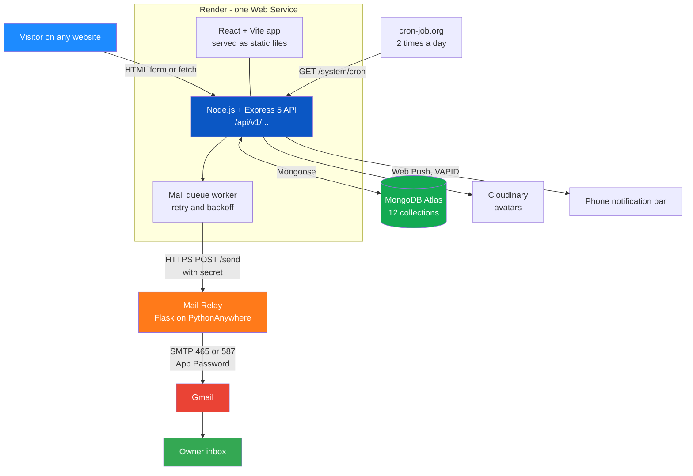
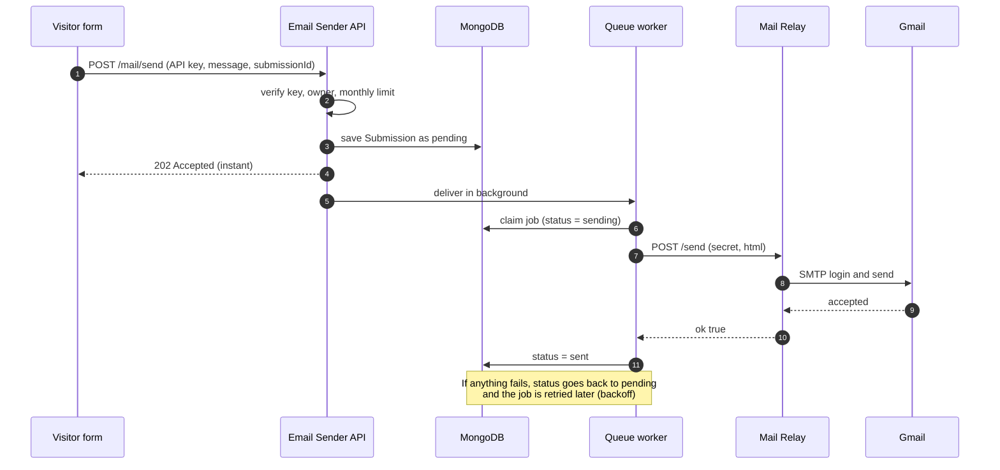
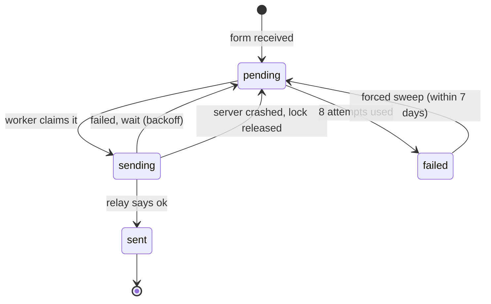
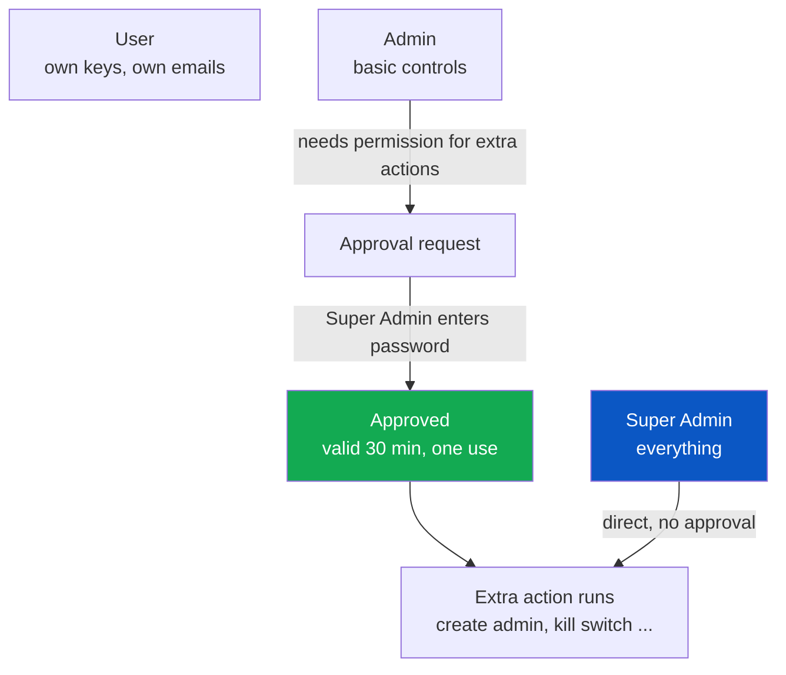
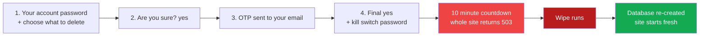

<div align="center">


[](https://git.io/typing-svg)

<p><sub><b>⚡ CORE STACK</b></sub></p>
<p>
  
  
  
  
  
  
</p>
<p><sub><b>🖥️ BACKEND PACKAGES · <code>backend/package.json</code></b></sub></p>
<p>
  
  
  
  
  
  
  
  
  
  
  
  
</p>
<p><sub><b>🎨 FRONTEND PACKAGES · <code>frontend/package.json</code></b></sub></p>
<p>
  
  
  
  
  
  
  
  
  
  
</p>
<p><sub><b>🔌 SERVICES &amp; PLATFORM</b></sub></p>
<p>
  
  
  
  
  
  
  
  
</p>

<p>
  
  
  
</p>

**[📖 Read the Docs Below](#-overview)** &nbsp;·&nbsp;
**[🚀 Getting Started](#-getting-started)** &nbsp;·&nbsp;
**[🧠 Why I Built It This Way](#-the-why-book--every-big-decision-explained)** &nbsp;·&nbsp;
**[🐛 Report an Issue](../../issues)**

</div>


## 📖 Overview

**Email Sender** is a full-stack **contact-form API service**. It does the same job as well-known services such as Formspree or Web3Forms, but you own every line of it.

Here is the idea in one picture. You have a website with a "Contact me" form. When a visitor fills it in and presses **Send**, you want the message to arrive in **your Gmail inbox**. Email Sender is the middle part that makes this happen safely:

1. You create an account and generate an **API key**.
2. You paste a small form (or a few lines of code) into your website. The form contains your API key.
3. A visitor presses Send. Email Sender checks the key, saves the message, and delivers it to your inbox as a clean, good-looking email.
4. You see every message again in your dashboard, with the sender's IP address, the exact page it was sent from, and its delivery status.

> **A simple way to think about it:** Email Sender is like a **post office with a safe**. The visitor hands in a letter. The post office first locks a copy in the safe (the database), and only then sends the letter on its way. If the delivery van breaks down, the letter is still in the safe, and the post office tries again later. Nothing is ever lost.

It is not "just a form handler". Around that one idea the project grows into a complete platform: OTP-based accounts, an admin panel, a permission system between admins, a self-destruct **Kill Switch**, phone notifications, and an installable mobile app.

<p align="center">
  
</p>

<div align="center">

|  | 58 | 12 | 14 | 34 | 23,000+ |
|:---:|:---:|:---:|:---:|:---:|:---:|
| | **API Endpoints** | **Database Collections** | **Code Languages in the Copy-Paste Box** | **React Components** | **Lines of Code** |

</div>

> 🙋 **Built by one person.** Every part of this project — backend, mail relay, frontend, design, PWA, documentation — was designed and written by a single developer, **entirely from a mobile phone**. That fact explains many of the choices you will read about later (for example: why there are browser-friendly diagnostic URLs, and why the dashboard has its own API tester page).

---

## 📑 Table of Contents

- [Overview](#-overview)
- [How to Read This Document](#-how-to-read-this-document)
- [Words You Will Meet (Mini Glossary)](#-words-you-will-meet-mini-glossary)
- [Features](#-features)
- [Architecture](#%EF%B8%8F-architecture)
  - [The Life of One Message](#-the-life-of-one-message)
- [Tech Stack](#-tech-stack)
- [Project Structure](#-project-structure)
- [Getting Started](#-getting-started)
- [Using the API (Embed on Your Website)](#-using-the-api-embed-on-your-website)
- [The Why Book — Every Big Decision Explained](#-the-why-book--every-big-decision-explained)
- [My Playbook — The Tactics I Followed](#-my-playbook--the-tactics-i-followed)
- [Deployment Guide](#%EF%B8%8F-deployment-guide)
- [API Reference](#-api-reference)
- [Data Model](#%EF%B8%8F-data-model)
- [Security & Reliability](#%EF%B8%8F-security--reliability)
- [Honest Limitations](#-honest-limitations)
- [Troubleshooting](#-troubleshooting)
- [Roadmap](#%EF%B8%8F-roadmap)
- [Credits](#-credits)
- [License](#-license)


## 🧭 How to Read This Document

This README is written like a **small book**. You do not have to read it from the first line to the last.

| If you are… | Start here |
|---|---|
| **A complete beginner** who wants to understand the project | Read [Overview](#-overview) → [Glossary](#-words-you-will-meet-mini-glossary) → [The Life of One Message](#-the-life-of-one-message) → [The Why Book](#-the-why-book--every-big-decision-explained) |
| **Someone who only wants to use it** | Jump to [Getting Started](#-getting-started) and [Using the API](#-using-the-api-embed-on-your-website) |
| **A developer who wants to learn the design** | Read [Architecture](#%EF%B8%8F-architecture), [The Why Book](#-the-why-book--every-big-decision-explained) and [My Playbook](#-my-playbook--the-tactics-i-followed) |
| **Someone deploying it** | Go to [Deployment Guide](#%EF%B8%8F-deployment-guide) and [Troubleshooting](#-troubleshooting) |

Throughout the document you will see these small markers:

- 💡 **Simple words** — a plain-language explanation of a technical idea.
- 🤔 **Why not the easy way?** — the reason I chose a harder solution, and which easier alternatives I rejected.
- ⚠️ **Trade-off** — nothing is free; this marks what I gave up in exchange.

---

## 📚 Words You Will Meet (Mini Glossary)

You do not need to know these words before you start. Come back to this table whenever a word looks unfamiliar.

| Word | What it means in simple language |
|---|---|
| **API** | A set of "doors" on a server. Your website knocks on a door (a URL), sends some data, and gets an answer back. |
| **API key** | A long secret text that proves "this request comes from this account". Like a house key. |
| **Backend** | The part of the project that runs on a server: it stores data, checks rules and sends emails.      -76D04B?style=flat-square&logo=nodemon&logoColor=white) |
| **Frontend** | The part you see and touch in the browser: pages, buttons, forms.     |
| **Endpoint** | One specific door of the API, for example `POST /api/v1/mail/send`. |
| **Database** | An organised storage place for data. This project uses **MongoDB**. |
| **Collection** | In MongoDB, a collection is like a table: `users`, `submissions`, and so on. |
| **OTP** | *One-Time Password.* A 6-digit code sent to your email that works only once and expires quickly. |
| **JWT** | *JSON Web Token.* A signed "ticket" the server gives you after login, so you do not need to type your password for every click. |
| **Cookie (httpOnly)** | A tiny piece of data the browser stores and sends automatically. *httpOnly* means JavaScript cannot read it, which protects it from many attacks. |
| **SMTP** | The standard "language" that mail servers use to send email. |
| **Relay** | A small middle server that passes a message along. Here: a tiny Flask app that hands emails to Gmail. |
| **Queue / Outbox** | A waiting list. Messages wait there until they are delivered. |
| **Retry & backoff** | If something fails, try again — but wait a little longer each time so you do not hammer a broken service. |
| **Idempotent** | An operation that gives the same result even if it is repeated. Sending the same request twice does **not** create two emails. |
| **Rate limit** | A rule such as "20 requests per minute". It stops abuse and spam. |
| **CORS** | A browser safety rule about which websites may talk to which server. |
| **PWA** | *Progressive Web App.* A website that can be installed on a phone like a normal app. |
| **Service Worker** | A background script of a PWA. It handles offline pages and push notifications. |
| **Web Push** | Notifications that appear in the phone's notification bar, even when the app is closed. |
| **VAPID** | A pair of keys that proves to push services that notifications really come from your server. |
| **Hash** | A one-way scrambled version of a secret. You can check a password against a hash, but you cannot turn the hash back into the password. |
| **TTL index** | A MongoDB feature that automatically deletes documents after a set time. |
| **Cold start / sleeping server** | Free hosting often puts a server to sleep when nobody uses it. The first visitor wakes it up and waits a little. |

---

## ✨ Features

### 📨 The Core: Form-to-Inbox API

- **One endpoint does the main job:** `POST /api/v1/mail/send`. It accepts JSON, or a normal HTML form (`application/x-www-form-urlencoded`), so it works even from a plain `<form>` tag with no JavaScript at all.
- **Save first, send later.** The message is written to the database *before* any email is attempted. The visitor gets an instant `202 Accepted`; delivery continues in the background.
- **Self-healing delivery.** Failed sends are retried automatically with growing waiting times (10 s → 30 s → 1.5 min → 5 min → 15 min → 1 h → 3 h), up to 8 attempts. A sleeping server wakes up and instantly flushes everything that was waiting.
- **No duplicates.** The form attaches a unique `submissionId`. If the same message arrives twice (for example because of a retry), only one email is created.
- **Rich, safe emails.** Every email shows sender, subject, message, IP address and the **full link of the page** the form was filled on (even `http://localhost:5173/contact`). All visitor text is HTML-escaped, so nobody can inject code into your inbox. Pressing **Reply** goes straight to the visitor.
- **Spam defence.** A hidden "honeypot" field catches simple bots; rate limits protect the endpoint; a monthly email limit protects your Gmail quota.
- **14 ready-made code snippets** in the dashboard — HTML form, plain HTML, JavaScript, React, Next.js, Node.js, PHP, Python, Java, C#, Go, Ruby, Dart/Flutter and cURL — each with VS Code–style colours and Prettier-style formatting, ready to copy.

### 🔐 Accounts & Security

- **Register with OTP.** The account is *not created* until the email code is verified. The username is auto-filled from the part of the email before `@` (and stays editable).
- **Forgot password with OTP.** A 30-second wait between resends. The API gives the *same* answer whether the email exists or not, so nobody can use it to discover who has an account.
- **Safe login sessions.** Short-lived access token + longer refresh token, both stored in **httpOnly cookies**. Blocked users are locked out immediately, even with an old token.
- **Login history.** The last 20 logins (IP + time) are recorded for every user and are visible to admins.
- **Avatar upload** to Cloudinary, with temporary files cleaned up.

### 🛡️ Admin Tools

- **Admin dashboard** with platform statistics.
- **User management:** list, search, block / unblock, delete.
- **Directory:** every user's email and API keys, searchable.
- **Login history:** every user's logins with IP address and timestamp.
- **All emails:** every message sent through any API key, with IP, source page and delivery status — designed like the user's own dashboard.
- **Two admin levels:** *Admin* and *Super Admin*. Dangerous actions need the Super Admin's **approval** (see [the role system](#-decision-6--two-kinds-of-admin-and-a-permission-system)).
- **Broadcast notices:** an admin can push an important message that appears in the bell, in the phone's notification bar, and as a **pop-up that cannot be closed for 5 seconds** so people actually read it.

### 💣 The Kill Switch

A deliberately hard-to-trigger, **irreversible** emergency tool. The Super Admin chooses what to destroy (emails, API keys, users, admins, uploaded files, the entire database, or — if explicitly enabled — the code). It needs **five confirmations** and then runs a **10-minute site-wide countdown with no cancel button**. When it finishes, the system restarts fresh and automatically, with no manual server restart.

### 🔔 Notifications

- In-app **bell with an unread badge**, like WhatsApp.
- **Phone notification bar** alerts (Web Push) with the logo, *what happened* and *why you received it*.
- Notifications are created for: new emails, approval requests and decisions, new users, blocks, role changes, API key changes, password changes, and admin notices.
- Old notifications delete themselves after 60 days.

### 📱 Frontend Experience

- **React 19 + Vite**, hand-written CSS with design tokens — no UI library.
- **Dark and Light themes**, both built on the logo's **blue + orange** palette with blue→orange gradients, and no "flash" of the wrong theme when the page loads.
- **Installable PWA** with an offline page and app shortcuts.
- **Animated everything, with respect:** counting numbers, a glowing quota ring that changes colour every 10 %, a smooth email-activity chart drawn by hand in SVG, an animated boot screen, and full support for `prefers-reduced-motion`.
- **Postman-style API tester** inside the dashboard: it shows the response, the time in milliseconds and the size in bytes — built because the whole project is tested from a phone.
- **Live system status page** that shows the Kill Switch countdown to every visitor.
- **Built-in documentation book (`/docs`)** — this very README, turned into a book-style web page with a cover, contents, chapters, dark/light mode and a **PDF download** button. It is generated from `README.md` on the server, so editing the README updates the page by itself. Anyone can read and download it; only admins can see how many times it was downloaded.

---

## 🏗️ Architecture

<p align="center">
  
</p>

<details>
<summary>Mermaid source (for editing the diagram)</summary>


</details>

💡 **Simple words.** There are only **three places** where the project runs:

| Place | What lives there | Why there |
|---|---|---|
| **Render** (free Web Service) | The Node.js API **and** the built React website, together | One service means one deploy, one URL, and no cross-site cookie problems |
| **MongoDB Atlas** (free cluster) | All data | A free, managed database; no server to maintain |
| **PythonAnywhere** (free account) | The tiny Flask **Mail Relay** | Render's free plan blocks SMTP; PythonAnywhere allows Gmail SMTP |

Two optional helpers complete the picture: **Cloudinary** stores profile pictures, and **cron-job.org** pings the server twice a day.

### 🔄 The Life of One Message

<p align="center">
  
</p>

<details>
<summary>Mermaid source</summary>


</details>

Let us walk through it slowly, step by step.

**Step 1 — The visitor presses Send.** The form sends the name, email, subject and message to `POST /api/v1/mail/send`. The API key travels in the `x-api-key` header, or in a hidden form field named `access_key`.

**Step 2 — The gatekeeper (`verifyApiKey`).** Before anything is saved, the server asks five questions:
1. Is there an API key at all? *(No → 401)*
2. Does this key exist? *(No → 401)*
3. Is the key switched on? *(No → 403)*
4. Is the key's owner blocked? *(Yes → 403)*
5. Has the owner already used up this month's limit? *(Yes → 429)*

**Step 3 — The honeypot and the rules.** A hidden field called `botcheck` is invisible to humans, but robots fill in everything. If it contains text, the server quietly answers "OK" and throws the message away — the bot thinks it succeeded. Real messages are checked for length (name ≤ 100, subject ≤ 200, message ≤ 5,000 characters) and for a valid email address.

**Step 4 — Save first.** The message is stored in MongoDB with the status `pending`. This is the most important step of the whole project. From this moment the message **cannot be lost**, whatever happens next.

**Step 5 — Answer instantly.** The visitor receives `202 Accepted` — "we got it, delivery is in progress". They do not wait for Gmail.

**Step 6 — Deliver in the background.** A worker *claims* the message (changing `pending` → `sending` in one atomic step, so two workers can never take the same message) and calls the Mail Relay over HTTPS with a shared secret.

**Step 7 — The relay talks to Gmail.** The Flask relay opens an SMTP connection to Gmail (port 465 first, then 587 as a fallback), signs in with an App Password and sends the message.

**Step 8 — Success or retry.** On success the status becomes `sent`. On failure the message goes back to `pending` with a "try again at" time. The state machine looks like this:

<p align="center">
  
</p>

<details>
<summary>Mermaid source</summary>


</details>

**Step 9 — Everybody is told.** The key's owner and every admin get a notification (bell + phone). The owner can open the full email details in the dashboard at any time.


---

## 🧰 Tech Stack

<div align="center">

| Layer | Technology |
|---|---|
| **Backend** |         |
| **Database** |  |
| **Mail Relay** |    |
| **Frontend** |     |
| **PWA** |  -FF7A1A?style=flat-square)  |
| **Services** |   |
| **Deployment** |    |

</div>

> 💡 **Notice what is missing.** There is no UI library (no Material UI, no Bootstrap, no Tailwind), no state-management library (no Redux), no rate-limit package, no syntax-highlighting package, no code-formatting package and no WebSocket library. All of those were written by hand on purpose. The reasons are in [The Why Book](#-the-why-book--every-big-decision-explained).

---

## 📁 Project Structure

```text
Email-Sender/
├── package.json                  # Root scripts: "build" (frontend + backend) and "start"
├── render.yaml                   # Render Blueprint — creates the whole service in one click
├── DEPLOY.md                     # Step-by-step deployment guide
├── .gitignore                    # Keeps .env and config.py (secrets) out of GitHub
│
├── backend/
│   ├── package.json
│   ├── .env.example              # Template for every environment variable
│   ├── config.example.py         # Template for the relay's secret file
│   ├── mail-relay-pythonanywhere.py   # The Flask mail relay (contains NO secrets)
│   ├── API.md                    # Short API notes
│   ├── public/temp/              # Temporary upload folder (emptied after each upload)
│   └── src/
│       ├── index.js              # Start-up: connect DB → prepare DB → start server → start queue
│       ├── app.js                # Express app: CORS, kill gate, routes, serves the React build
│       ├── constants.js          # OTP lengths, limits, kill-switch settings
│       ├── db/index.js           # MongoDB connection + prepareDatabase() (collections + indexes)
│       ├── routes/               # URL → controller maps (8 files)
│       ├── controllers/          # The "what happens" logic for each endpoint (8 files)
│       ├── services/             # Reusable engines: mailQueue, mailer, email, otp, push,
│       │                         #   notification, killSwitch
│       ├── middlewares/          # auth (JWT), apiKey, rateLimit, killGate, multer
│       ├── models/               # 11 Mongoose schemas
│       └── utils/                # ApiError, ApiResponse, asyncHandler, validators, username,
│                                 #   sourceUrl, approval, cloudinary
│
└── frontend/
    ├── index.html                # Boot loader + anti-flash theme script
    ├── vite.config.js
    ├── public/                   # sw.js (service worker), manifest, icons, offline.html
    └── src/
        ├── main.jsx              # Providers + service-worker registration
        ├── App.jsx               # All routes
        ├── services/api.js       # ONE file for every API call + auto token refresh
        ├── context/              # Auth, Theme, Notification state
        ├── hooks/                # useAsync, useCooldown, usePush, useInstall, useExtra
        ├── lib/                  # embedForm, highlight, formatCode, push, pwa, pending, format
        ├── components/           # 33 shared components (AppShell, AlertPopup, QuotaRing ...)
        ├── features/             # One folder per area:
        │   ├── auth/             #   Login, Register, VerifyRegister, ForgotPassword, ResetPassword
        │   ├── dashboard/        #   User dashboard, chart, quota ring
        │   ├── apikeys/          #   Create / list / delete API keys
        │   ├── mail/             #   Send & embed page (API tester + 14 code snippets)
        │   ├── notifications/    #   Notification centre
        │   ├── profile/          #   Profile, avatar, password
        │   ├── admin/            #   Stats, Users, Directory, Broadcast, Create admin
        │   ├── approvals/        #   Permission requests
        │   ├── killswitch/       #   The 5-step Kill Switch wizard
        │   └── system/           #   Public status + countdown page
        └── styles/               # index.css (design tokens) + page stylesheets
```

---

## 🚀 Getting Started

### Prerequisites

- **Node.js 20 or newer** (the Render Blueprint uses 22)
- **A MongoDB database.** The free [MongoDB Atlas](https://www.mongodb.com/atlas) cluster is perfect.
- **A Gmail account** with *2-Step Verification* turned on, so you can create an **App Password** (a special 16-character password for apps — your normal Gmail password will not work).
- *(Optional)* A [Cloudinary](https://cloudinary.com) account, only if you want profile pictures.
- *(Optional)* A [PythonAnywhere](https://www.pythonanywhere.com) account, only for production (see [Deployment](#%EF%B8%8F-deployment-guide)). **For local testing you do not need it.**

### 1 · Clone the repository

```bash
git clone https://github.com/duttaanubhab777-code/Email-Sender.git
cd Email-Sender
```

### 2 · Configure the backend

```bash
cd backend
cp .env.example .env
npm install
```

Open the new `.env` file and fill in the values. The **minimum** needed to run locally:

| Variable | What to put | Notes |
|---|---|---|
| `MONGODB_URI` | The link from Atlas (Connect → Drivers) | Paste it exactly as given. The code adds the database name itself. If your password contains `@ : / ?`, URL-encode it. |
| `ACCESS_TOKEN_SECRET` | A long random text | Generate one with the command below |
| `REFRESH_TOKEN_SECRET` | A **different** long random text | Same command |
| `SUPER_ADMIN_EMAIL` | **Your** email | Whoever registers with this email becomes the Super Admin |
| `MAIL_PROVIDER` | `smtp` | For local testing, send directly through Gmail |
| `SMTP_HOST` / `SMTP_PORT` | `smtp.gmail.com` / `587` | |
| `SMTP_USER` / `SMTP_PASS` | Your Gmail address / your App Password | |
| `CORS_ORIGIN` | `http://localhost:5173` | The address of the frontend dev server |

Generate a strong random secret (run it twice, once per secret):

```bash
node -e "console.log(require('crypto').randomBytes(48).toString('hex'))"
```

<details>
<summary><b>Every environment variable explained</b></summary>

| Variable | Purpose | Default / Note |
|---|---|---|
| `PORT` | Server port | `3000` locally. **Do not set it on Render** — Render provides it. |
| `CORS_ORIGIN` | Which website may call the app API with cookies | Leave **empty** on Render (same origin) |
| `TRUST_PROXY` | Number of proxies in front of the server | Set `1` on Render so real visitor IPs are visible |
| `MONGODB_URI` | Database connection link | Required |
| `ACCESS_TOKEN_SECRET` / `ACCESS_TOKEN_EXPIRY` | Signs short-lived login tokens | Expiry `1d` |
| `REFRESH_TOKEN_SECRET` / `REFRESH_TOKEN_EXPIRY` | Signs long-lived refresh tokens | Expiry `10d` |
| `OTP_SECRET` | Secret used to scramble OTP codes in the database | Falls back to `ACCESS_TOKEN_SECRET` |
| `CLOUDINARY_CLOUD_NAME` / `_API_KEY` / `_API_SECRET` | Avatar storage | Optional |
| `SUPER_ADMIN_EMAIL` | The account that becomes Super Admin when it registers | Required for admin features |
| `MAIL_PROVIDER` | How emails leave the server: `relay`, `brevo`, `smtp` or `auto` | `auto` picks Brevo if a key exists, else relay if a URL exists, else SMTP |
| `MAIL_RELAY_URL` | Address of your PythonAnywhere relay (`…/send`) | `/send` is added automatically for `pythonanywhere.com` addresses |
| `MAIL_RELAY_SECRET` | Shared secret — must equal `RELAY_SECRET` in the relay's `config.py` | |
| `BREVO_API_KEY`, `MAIL_FROM` | Optional alternative provider | |
| `SMTP_HOST`, `SMTP_PORT`, `SMTP_USER`, `SMTP_PASS` | Direct SMTP (works locally; blocked on Render free) | |
| `CRON_SECRET` | Protects `/system/cron` and `/system/mail-queue` | Without it those two URLs are switched off |
| `VAPID_PUBLIC_KEY`, `VAPID_PRIVATE_KEY`, `VAPID_SUBJECT` | Phone push notifications | Create keys with `npm run vapid`. Without them, only phone push is disabled. |
| `KILL_SWITCH_PASSWORD_HASH` | The Kill Switch's own password, stored as a **bcrypt hash** | Preferred |
| `KILL_SWITCH_PASSWORD` | Plain-text alternative | Less safe |
| `KILL_COUNTDOWN_SECONDS` | Length of the countdown | `600` (10 minutes) |
| `KILL_ALLOW_CODE_DELETE` | Allow the "delete source code" target | `false` — keep it that way on hosting |
| `KILL_DRY_RUN` | Run the whole flow and countdown but **delete nothing** | Use `true` to test safely |

Create the Kill Switch password hash:

```bash
node -e "import('bcrypt').then(b=>b.default.hash('YOUR_PASSWORD',10).then(console.log))"
```

Create push keys:

```bash
npm run vapid
```
</details>

### 3 · Start the backend

```bash
npm run dev
```

You should see something like:

```text
MongoDB connected !! DB HOST: ...
[DB] ready — 11 models synced
server is running on port 3000
[mail] provider = smtp
```

> 💡 If you see a line starting with `[mail] ⚠`, it tells you exactly which setting is missing. The server is designed to **complain clearly instead of failing mysteriously**.

### 4 · Start the frontend

Open a second terminal:

```bash
cd frontend
npm install
npm run dev
```

Open **http://localhost:5173**. In development the frontend automatically talks to `http://localhost:3000/api/v1`. In production it uses the same address it was loaded from (`/api/v1`).

### 5 · Create your first account

1. Click **Create account** and register with the **same email** you wrote in `SUPER_ADMIN_EMAIL`.
2. A 6-digit code arrives in your inbox. Enter it. Your account is created and you are logged in as **Super Admin**.
3. Open **API keys** → create a key named, for example, `My Portfolio`.
4. Open **Send & embed** → pick your key → copy the code for your language.

### 6 · Run it as one app (production style)

From the project root:

```bash
npm run build     # installs and builds the frontend, then installs the backend
npm start         # starts the backend, which also serves the built frontend
```

When `frontend/dist` exists, Express serves the website itself. That is exactly what happens on Render.

---

## 🔌 Using the API (Embed on Your Website)

### The simplest way — a plain HTML form

```html
<form action="https://YOUR-APP.onrender.com/api/v1/mail/send" method="POST">
  <input type="hidden" name="access_key" value="YOUR_API_KEY" />
  <input type="text" name="name" placeholder="Your name" required />
  <input type="email" name="email" placeholder="Your email" required />
  <input type="text" name="subject" placeholder="Subject" required />
  <textarea name="message" placeholder="Your message" required></textarea>
  <button type="submit">Send</button>
</form>
```

No JavaScript is needed. (The dashboard also gives you a beautiful, animated version of this form with dark/light mode, a wake-up ping, automatic retries and a "sent" animation.)

### From JavaScript

```js
const res = await fetch("https://YOUR-APP.onrender.com/api/v1/mail/send", {
  method: "POST",
  headers: {
    "Content-Type": "application/json",
    "x-api-key": "YOUR_API_KEY",
  },
  body: JSON.stringify({
    senderName: "Rahim",
    senderEmail: "rahim@example.com",
    subject: "Hello!",
    message: "I loved your portfolio.",
    submissionId: "a-unique-id-12345", // makes retries safe
    pageUrl: window.location.href,     // shows the exact page in your inbox
  }),
});
console.log(res.status); // 202
```

### From the command line

```bash
curl -X POST "https://YOUR-APP.onrender.com/api/v1/mail/send" \
  -H "Content-Type: application/json" \
  -H "x-api-key: YOUR_API_KEY" \
  -d '{"senderName":"Rahim","senderEmail":"rahim@example.com","subject":"Hello","message":"Testing from cURL"}'
```

### What you get back

```json
{
  "statusCode": 202,
  "success": true,
  "message": "Message received. Delivery is in progress.",
  "data": { "id": "665f…", "status": "pending", "createdAt": "2026-10-16T10:30:00.000Z" }
}
```

### Accepted fields

| Field | Required | Limit | Notes |
|---|:---:|---|---|
| `senderName` (or `name`) | ✅ | 100 chars | |
| `senderEmail` (or `email`) | ✅ | 254 chars, must look like an email | Becomes the **Reply-To** of the email you receive |
| `subject` | ✅ | 200 chars | |
| `message` | ✅ | 5,000 chars | |
| API key | ✅ | — | Send it as the `x-api-key` header, the `access_key` field, or the `apiKey` query parameter |
| `submissionId` | optional | 8–64 chars: letters, digits, `_`, `-` | Same id twice = one email only |
| `pageUrl` | optional | `http(s)` links only | Full page link. If missing, the browser's `Referer`/`Origin` is used |
| `botcheck` | optional | — | Hidden honeypot. **Leave empty** in real forms |
| `redirect` | optional | same website only | If given (and from the same origin), the server answers `303` and sends the browser there |

### Status codes you may see

| Code | Meaning |
|:---:|---|
| `200` | The same `submissionId` was sent before and that message is already delivered |
| `202` | Accepted. Saved safely; delivery is in progress |
| `400` | A field is missing or invalid |
| `401` | API key missing or wrong |
| `403` | Key switched off, or its owner is blocked |
| `429` | Too many requests (20 per minute per IP) **or** the monthly email limit (default 500) is used up |

> 🌐 **The mail route accepts requests from any website** (`CORS: *`). That is deliberate — a contact form must work from *your* domain, which the server cannot know in advance. The API key is what protects it.


## 🧠 The Why Book — Every Big Decision Explained

> Most README files tell you **what** a project does. This chapter tells you **why** it was built this way.
>
> A lot of the choices below are *harder* than the obvious solution. That was on purpose. For each decision you will find: **the easy way** (what most beginners would do), **what I did instead**, **why**, and **the trade-off** (the price I paid). If you are learning, this is the most valuable part of the document.

<div align="center">

| # | Decision | The easy way I did **not** take |
|:---:|---|---|
| 1 | A separate **Mail Relay** | Send Gmail SMTP straight from the Node server |
| 2 | **Save first, send later** (outbox) | Send the email inside the request and wait |
| 3 | A server that is **allowed to sleep** | Ping the server every 14 minutes to keep it awake |
| 4 | **One service** for frontend + backend | Host the website and the API in two places |
| 5 | **OTP** for register / reset, **password-only** login | OTP for everything, or no OTP at all |
| 6 | **Two admin levels + approvals** | One "admin" role with full power |
| 7 | A **5-step Kill Switch** that survives restarts | A single "delete all" button |
| 8 | **Polling + Web Push** | WebSockets / Socket.IO |
| 9 | **Hand-written** UI, highlighter, formatter, rate limiter | Install a package for each of them |
| 10 | A **hand-made service worker** (PWA) | A PWA plugin that generates it |

</div>

---

### 🚚 Decision 1 — Why a separate Mail Relay?

**The problem.** I host the server on Render's free plan. Free plans on Render **block the outgoing SMTP ports** (25, 465 and 587). That is the "road" every email program uses to talk to Gmail. So the obvious code — `nodemailer` + Gmail — works on my laptop and then silently fails after deploy.

**The easy way.** Pay for a bigger hosting plan, or use a paid email API.

**What I did instead.** I split the job in two:

```text
Render (can use HTTPS, port 443)  ──HTTPS──▶  PythonAnywhere relay  ──SMTP──▶  Gmail
```

HTTPS is never blocked, so Render can talk to my small **Flask relay** on PythonAnywhere (which *is* allowed to reach Gmail). The relay's whole job: receive "send this email", log in to Gmail, send it, and report back `ok: true` or a clear error.

**Why it is a good design (not only a workaround):**

- **The email provider is swappable.** `MAIL_PROVIDER` can be `relay`, `brevo` or `smtp`. The rest of the code just calls `sendMail()` and never knows which one is used. If one provider has a bad day, I change one environment variable.
- **Secrets stay where they belong.** The relay file contains **no secret at all** — the Gmail address, the App Password and the shared secret live in a separate `config.py` that is never pushed to GitHub. That means I can publish the relay code publicly and still be safe.
- **The relay checks a secret.** Anyone who finds the URL still cannot send mail. The secret is compared with `hmac.compare_digest`, a *timing-safe* comparison (a normal `==` can leak information through tiny timing differences).
- **It tries two doors.** Port **465** (SSL from the first byte) is tried first, then **587** (STARTTLS). If the password is wrong it stops immediately, because trying the other port cannot help.
- **The timeouts are nested on purpose.** The relay waits at most 12 s per port (24 s for two). The Node server waits 45 s for the relay. The inner timeout is always shorter than the outer one, so the relay always gets the chance to report a *real* error before Node gives up.
- **It is easy to debug from a phone.** Open `/health` to see whether it is configured. Open `/diag?key=SECRET&to=you@gmail.com` to test **each port separately** and even send a test mail. The error messages say what to fix ("App Password wrong?", "port blocked?").
- **Emails are properly built.** Each message has both a plain-text and an HTML version (better for spam filters and old mail apps), a proper `Message-ID`, `Date` and `Reply-To`.

**Other options I tried or kept.** Brevo (an email API) is still supported as an optional provider. I also experimented with a Google Apps Script sender. Both had problems in my testing, which is why the relay became the recommended path.

**⚠️ Trade-off.** One more moving part to maintain. A free PythonAnywhere web app must be **renewed every 3 months** with one button click. Gmail itself allows roughly 500 emails per day.

---

### 💾 Decision 2 — Why "save first, send later"?

**The easy way.**

```js
// Beginner version
app.post("/send", async (req, res) => {
  await sendEmail(req.body);      // wait for Gmail…
  res.json({ ok: true });         // …then answer
});
```

It is short and it looks fine. But think about what can go wrong:

| What goes wrong | What the easy version does |
|---|---|
| Gmail is slow (5–20 s) | The visitor stares at a spinner |
| The relay is down for 2 minutes | The message is **lost forever** |
| The visitor double-clicks Send | **Two** emails |
| The server restarts in the middle | The message is **gone**, nobody knows |

**What I did instead — the "outbox" pattern.** The same idea banks use: *write it down first, then act*.

1. **Save** the message in MongoDB with `status: "pending"`.
2. **Answer** the visitor immediately (`202 Accepted`).
3. **Deliver** in the background. Success → `sent`. Failure → back to `pending` with a *next attempt time*.

<p align="center">
  
</p>

**The details that make it trustworthy:**

- **Atomic claiming.** A worker takes a message with one database command that says "if it is still `pending` *and* due, set it to `sending`". Because it is one atomic operation, two workers can never grab the same message.
- **Lock timeout.** A message marked `sending` also gets a `lockedAt` time. If the server dies mid-send, the sweep notices the stale lock (after 2 minutes, or 45 seconds right after a restart) and puts the message back in line. Nothing stays stuck.
- **Growing waits (backoff).** After each failure the waiting time grows: **10 s → 30 s → 90 s → 5 min → 15 min → 1 h → 3 h**, up to **8 attempts**. The first steps are short because a free server may fall asleep after about 15 minutes.
- **Failed is not forgotten.** Even a `failed` message stays in the database. A forced sweep can revive failures from the last 7 days.
- **Idempotency.** The form sends a unique `submissionId`. A *unique partial index* on `(apiKey, clientRef)` makes the database itself refuse a duplicate. When the duplicate arrives, the API simply returns the original message instead of making a second email.
- **A second outbox for system emails.** OTP codes and notification emails use a separate `MailJob` collection. It behaves the same way, but with quicker retries (5 s → 10 s → 20 s → 40 s → 60 s → 90 s), because an OTP is useless after a few minutes. Delivered jobs are **deleted immediately** (so no OTP code lingers in the database), and a MongoDB **TTL index** deletes expired ones by itself.
- **OTP never makes you wait too long.** The OTP endpoint waits at most **8 seconds** for the first delivery attempt. If it is not done, it still says "code sent" and keeps retrying in the background until the code expires.
- **Don't hammer a broken relay.** If a whole batch fails, the sweep stops instead of pushing every remaining message into a service that is clearly down.

**⚠️ Trade-off.** Delivery is *at-least-once*, not *exactly-once*. In the extremely rare case where Gmail accepts a message but the server crashes before it writes `sent`, that message could be sent a second time. For a contact form, a rare duplicate is far better than a lost message.

---

### 😴 Decision 3 — Why I let the server sleep

**The problem.** Render's free plan has a limited number of running hours per month and puts an idle server to sleep. A visitor who arrives while it sleeps waits about 30 seconds for the wake-up.

**The easy way.** Create a cron job that pings the server every 14 minutes so it never sleeps.

**Why I refused.** A server that is awake 24 hours a day uses up the monthly free hours on **one project**. I want to host more than one project. So the server *must* be allowed to sleep — which means the design must be **safe even when the server is asleep**.

**The tactics I used:**

| Tactic | What it does |
|---|---|
| **Wake-on-form-open** | The embeddable form calls `GET /api/v1/mail/ping` (answers `204`) as soon as it becomes visible, is focused or touched. The server wakes up **while the visitor is still typing**, so it is ready when they press Send. |
| **Boot sweep** | Two seconds after *any* wake-up (visit, deploy, cron), the server runs a **forced sweep**: it cancels all waiting times and sends everything that was waiting. |
| **Cron twice a day** | cron-job.org calls `/api/v1/system/cron` at 08:00 and 20:00. That is *not* a keep-alive — it only wakes the server briefly so stuck mail can leave. |
| **Browser-side outbox** | If the server cannot be reached at all, the form keeps the message in the visitor's `localStorage` and retries after **3 s, 8 s, 20 s, 45 s, 90 s**. Anything left is sent the next time the page opens (and dropped after 24 hours). The same `submissionId` makes these retries safe. |
| **Health check stays green** | During a Kill Switch countdown the whole API returns `503`, but `/mail/ping` is allowed through. Otherwise Render would think the server is "sick" and restart it in the middle of the countdown. |

**⚠️ Trade-off.** The first visitor after a long silence can wait longer, and mail may sit in the database until something wakes the server. Nothing is *lost*, but it can be *late*.

---

### 🏠 Decision 4 — Why one service for the website and the API?

**The easy way.** Put the React site on Netlify or Vercel and the API on Render.

**What I did instead.** After `npm run build`, the Express server itself serves the built React files. One URL, one deploy.

**Why:**

- **No CORS pain for the app.** Browsers get strict when a site on `a.com` calls an API on `b.com` with cookies. When both are on the same address, the problem simply does not exist.
- **Cookies just work.** The login uses httpOnly cookies. Cookies across two different websites need `SameSite=None`, third-party cookie permission and more. Same origin avoids all of it.
- **Half the hosting work.** One build command, one start command, one health check.
- **Correct caching.** Files inside `/assets/` have hashed names, so they are cached for a **year** (`immutable`). Everything else (`index.html`, `sw.js`, the manifest) is `no-cache`, so a new deploy is visible immediately.
- **Refresh works on any page.** Any `GET` that is not `/api/...` returns `index.html`, so reloading `/users/dashboard` does not give a 404. Unknown `/api` routes still return a clean JSON `404`.

**Only the mail route is open to every website** (`CORS *`), because a contact form must work from the *customer's* domain. Everything else allows only the origin named in `CORS_ORIGIN`.

**⚠️ Trade-off.** The API and the website share one process. A very heavy website load could affect the API. For this project's size, that is an acceptable price.

---

### 🔑 Decision 5 — Why this exact login design?

This is a project about email, so I could have put an OTP on every action. I chose *where* an OTP is worth its cost.

| Action | Uses OTP? | Reason |
|---|:---:|---|
| **Register** | ✅ | Proves the person owns the email. No fake accounts. |
| **Forgot password** | ✅ | The email is the only proof of identity in this flow. |
| **Kill Switch** | ✅ | A dangerous action deserves one more proof. |
| **Normal login** | ❌ | Password + rate limit + hashing is the normal standard, and an OTP on every login would burn Gmail's daily quota and slow users down. |

**The security details behind the OTP:**

- 6 digits created with `crypto.randomInt` (a *cryptographically secure* random generator — not `Math.random`).
- Stored as an **HMAC-SHA256 hash** of `email:purpose:code` with a server secret. A database leak does not reveal live codes.
- Valid for **10 minutes** (5 for the Kill Switch). **5 wrong tries** cancel the code. A new code can be requested only after **30 seconds**.
- Checked with a timing-safe comparison, and **deleted atomically** (`findOneAndDelete`) when used, so the same code can never work twice.

**Register is a two-step dance — and the user does not exist until step two.**

1. Step 1 validates everything, uploads the avatar, **hashes the password immediately** and stores `{fullName, username, passwordHash, avatar}` inside the OTP record. *The real password is never written to the database in readable form, even temporarily.*
2. Step 2 checks the code and **only then creates the user**. Abandoned sign-ups leave no half-made accounts behind, and TTL cleans the OTP record by itself.

**Forgot-password never reveals who has an account.** Whether the email exists or not, the answer is the same sentence. Even the "please wait 30 seconds" error is swallowed for the same reason.

**Sessions.**

- An **access token** (short, default 1 day) and a **refresh token** (long, default 10 days) are stored in `httpOnly` + `secure` cookies. JavaScript on the page can never read them, which blocks the most common token-theft attacks.
- The refresh token is **also saved on the user's database record**. Logout, password reset, and *blocking* clear it, so a stolen or old token stops working immediately. A blocked user is also refused on every normal request (not only at login).
- In the frontend, if two requests fail with `401` at once, **only one refresh call is made** and both wait for it (a shared promise). Login, logout, kill-switch and approval calls are *excluded* from auto-refresh, because there a `401` means "wrong password", and retrying would count the wrong attempt twice.
- Login accepts **email or username** in one box.

**The Super Admin has no secret setup script.** Whoever registers with the email written in `SUPER_ADMIN_EMAIL` becomes the Super Admin automatically (checked only when a user is *newly created*). So the first owner is chosen by deployment settings, not by a hidden endpoint that could be attacked.

**Rate limits protect every door:**

| Door | Limit |
|---|---|
| Register / login / forgot password | 20 per 15 min per IP |
| OTP verify / resend | 15 per 15 min per IP |
| Username check | 30 per minute |
| `POST /mail/send` | 20 per minute per IP |
| Kill Switch steps | 5–10 per 15 min **per admin** |
| Approve a permission | 10 per 15 min per admin |
| Broadcast notices | 20 per hour per admin |
| Push subscribe / test | 40 per 15 min / 5 per 10 min |

---

### 👑 Decision 6 — Two kinds of admin, and a permission system

**The easy way.** One `isAdmin` flag. Every admin can do everything.

**The danger.** If one admin account is hacked — or one admin makes a mistake — the whole platform can be wiped, and the attacker could create more admins.

**What I did instead.**

<p align="center">
  
</p>

<details>
<summary>Mermaid source</summary>


</details>

| | **Basic controls** | **Extra controls** |
|---|---|---|
| What | Stats, view users/keys/emails/logins, block / unblock / delete a normal user, send broadcast notices | Create an admin, make or remove an admin, block/delete **another admin**, the Kill Switch |
| Super Admin | ✅ directly | ✅ directly |
| Admin | ✅ directly | ⚠️ only with a Super Admin **approval** |

**How an approval works — and why it is tight:**

1. The Admin sends a request: *action*, *target*, and an optional reason. The Super Admin gets a notification.
2. The request waits up to **24 hours**.
3. The Super Admin approves by **typing their own password again** (so a stolen browser session is not enough).
4. The approval is valid for **30 minutes** and works **exactly once**. When used, its status becomes `used`.
5. It only matches the **same admin, the same action and the same target**. An approval to block "Alice" cannot be reused to block "Bob", or by a different admin.
6. The check itself is one atomic database update, so two people cannot use the same approval at the same moment.

**More guard rails:** nobody can perform these actions on themselves, and **the Super Admin account can never be blocked, deleted or changed** through the API.

---

### 💣 Decision 7 — Why the Kill Switch is so strict

**The easy way.** A red "Delete everything" button with one confirm popup.

**What I did instead.** A deliberately heavy ritual. Each step defends against a *different* mistake or attack:

<p align="center">
  
</p>

<details>
<summary>Mermaid source</summary>


</details>

| Step | Defends against |
|---|---|
| 1 · Your account password + choose targets | Someone using a logged-in phone left on a table |
| 2 · "Are you sure?" → `yes` (anything else aborts) | A mis-tap |
| 3 · OTP to the admin's email | A stolen password |
| 4 · Final `yes` + the Kill Switch's **own** password | A stolen *account* — the attacker still needs a password that lives only in the server settings |
| Countdown | Gives everyone time to see it coming (the status page shows it live) |

**Targets** (you choose): email logs, API keys, regular users, admins, uploaded files, the whole database, or the code. `everything` expands into all of them.

**Engineering choices inside:**

- **No cancel route exists at all.** This is on purpose. A cancel button is something an attacker (or a panicking person) could also press. If you must stop it, you stop the server from the hosting dashboard.
- **The countdown is saved in the database** (`SystemState`). If the server restarts mid-countdown, it **resumes**. Restarting cannot be used as a cancel.
- **During the countdown the whole API returns `503`** (the `killGate`). Only `GET /system/status` (for the live timer) and the health ping are allowed through.
- **Order matters.** Uploaded files go first (the avatar links are needed to delete them), the database and code go last.
- **It heals itself.** After a full database wipe the server **re-creates every collection and index** (`prepareDatabase`), resets the rate limiter and the mail connection, and opens the site again. No manual restart. *(This was a real bug I hit: after a wipe, "Create account" loaded forever until I restarted the server by hand. Now it is automatic — and the same function also runs at every start-up, so a brand-new database needs no setup either.)*
- **Safe by default.** Deleting source code is switched off unless `KILL_ALLOW_CODE_DELETE=true`. `KILL_DRY_RUN=true` lets you run the entire ritual and countdown while deleting **nothing** — perfect for testing. File deletion is limited to paths *inside* the project folder.
- **Retries and limits.** A wipe step that fails is retried after 30 s (max 3 times). A wrong Kill Switch password closes the session after 3 tries. A Kill Switch session expires after 15 minutes.
- **The Super Admin is told** by email the moment it is armed.

---

### 🔔 Decision 8 — Why polling and Web Push, not WebSockets

**The easy way (for "real-time").** Socket.IO or WebSockets: a permanent open connection.

**Why not.**

- A permanent connection **keeps a free server awake**, which breaks [Decision 3](#-decision-3--why-i-let-the-server-sleep).
- Free hosting restarts and sleeps; sockets must reconnect and recover missed events.
- It adds a library and a whole new way to fail.

**What I did instead — two simple tools:**

1. **Light polling while the app is open.** Every 20 seconds the app asks `GET /notifications/unread-count`. It **skips the request when the tab is hidden**. This is cheap: one tiny request, and it is enough to update the WhatsApp-style badge, show a toast and bring up admin pop-ups.
2. **Web Push when the app is closed.** The server sends a push message through the browser's push service to the phone's notification bar. This needs **no open connection from my server** — the phone's operating system wakes the **service worker**.

**Notification design choices:**

- **Each notification says *what happened* and *why you got it*.** For example "📩 New email from Rahim — Your contact form just received a new message."
- **Creating a notification can never break the real job.** The helpers wrap everything in `try/catch`. If a push fails, the email is still saved.
- **Push is optional.** The `web-push` library is loaded lazily. Without VAPID keys, only phone push is disabled; the bell and everything else still work.
- **Security: allow-listed push hosts.** A subscription includes an `endpoint` URL that the *server* will later call. If anyone could submit any URL, the server could be tricked into calling internal addresses (an attack called SSRF). So only real push services are accepted (Google FCM, Mozilla, Apple, Windows).
- **Logout detaches the device.** Otherwise a second person who logs in on the same phone would receive the previous person's notifications.
- **Dead devices are cleaned up** when a push service says the subscription is gone.
- **Admin notices are special.** They create a notification with `alert: true`. On the phone they stay until dismissed (`requireInteraction`) and vibrate harder. In the app they open a **pop-up that cannot be closed for 5 seconds** (Esc and outside clicks are disabled; the timer pauses if the tab is hidden), and it keeps coming back until the user presses **OK**. Normal notifications never open this pop-up.
- **Housekeeping.** A TTL index deletes notifications after 60 days.

---

### 🛠️ Decision 9 — Why so many things are hand-written

Every package is code written by someone else, which I must download, keep updated, trust and ship to the user's phone. For small, well-understood jobs, writing it myself gave me **smaller downloads, full control and less risk**:

| Hand-written piece | Instead of | Why |
|---|---|---|
| **In-memory rate limiter** (30 lines) | `express-rate-limit` | Simple enough to read in one minute; also lets me reset all limits after a Kill Switch wipe. |
| **Syntax highlighter** (`highlight.js`, ~900 lines) | Prism / highlight.js packages | Zero dependency, tiny, outputs VS Code **Dark+/Light+** colours for 14 languages, and HTML-escapes everything. |
| **Prettier-style formatter** (`formatCode.js`) | Shipping Prettier | The copy box shows neat code (2 spaces, one rule per line, 80 columns) without a huge library. |
| **Design tokens + plain CSS** | A UI kit | One `data-theme` attribute switches the whole look. No heavy kit on a phone. |
| **Charts in SVG** | A chart library | A smooth, monotone curve with gradient and hover tooltip is only a little maths. |
| **Count-up numbers, quota ring** | Animation libraries | `requestAnimationFrame` plus an easing formula is enough. |
| **API wrapper** (`api.js`) | Axios | One small file: cookies, JSON/FormData handling, token refresh, kill-switch detection, a clean `ApiError`. |

**⚠️ Trade-off.** More code that I must test and maintain myself, and I give up battle-tested edge-case handling. The in-memory limiter, for example, forgets everything when the server restarts and works for **one** server only. It is a good fit for a single free instance, and would be replaced by a Redis-based limiter if the project grew.

---

### 📲 Decision 10 — Why I wrote my own service worker

A PWA plugin can generate a service worker in one line. But a generated worker caches aggressively and is hard to reason about — and a bad cache can leave users stuck on an old version. I wrote `sw.js` by hand with **three clear rules**:

1. **Pages (navigation):** *network first.* The newest `index.html` always wins; only when offline does the worker show `offline.html`.
2. **Static files** (`/assets/*`, icons, fonts): *stale-while-revalidate.* Show the cached copy instantly, and refresh it quietly in the background.
3. **The API: never cached, never touched.** Not even non-GET requests or other origins.

Other details: the cache name carries a version (`es-static-v3`) and old caches are deleted on activation; `skipWaiting` + `clients.claim` apply updates immediately; push messages are forwarded to the open app (for live badge updates) **and** always shown in the notification bar; the app-icon badge number is set where the browser supports it.

---

### 🧾 Smaller decisions, quickly

| Question | Answer |
|---|---|
| **Why save the page link (`sourceUrl`) and how is it protected?** | Owners want to know *which page* sent a message. A browser can claim any `pageUrl`, so when the request carries an `Origin` or `Referer`, the server trusts the claim only if it is from the same site; otherwise it uses the header instead. Only `http(s)` links are kept, with passwords stripped and a 500-character cap. |
| **Why escape everything in emails?** | A visitor could type `<script>` or HTML as their message. Every visitor-controlled value is HTML-escaped. Newlines are stripped from the subject and sender name to stop *header injection* (sneaking in extra email headers). |
| **Why a honeypot instead of CAPTCHA?** | A hidden field costs the visitor nothing and stops simple bots. A CAPTCHA adds friction to every real visitor. |
| **Why a monthly limit?** | Gmail allows only about 500 emails a day. A limit per user (default 500 per month, counted from the 1st, UTC) protects the shared mailbox. |
| **Why username from email?** | Fewer fields to fill. `jarvis@gmail.com` becomes `jarvis`; if it is taken, digits are added. The user can still edit it. |
| **Why store the API key in readable form?** | Admins can view keys in the Directory, and users can copy them again later. (See [Honest Limitations](#-honest-limitations) for the trade-off.) |
| **Why the same `{statusCode, success, message, data}` shape everywhere?** | One predictable shape means the frontend needs only one place to read responses and errors. `ApiError` and `ApiResponse` classes enforce it, and `asyncHandler` forwards every async error to one central error handler. |
| **Why `prepareDatabase()` at every start?** | It creates missing collections and indexes. A fresh database, a deploy to a new cluster and a post-Kill-Switch restart all work with **zero manual setup**. |
| **Why `unhandledRejection` is logged, not fatal?** | One surprising error in a background task should not take the whole service down. |
| **Why graceful shutdown?** | Render sends `SIGTERM` on every deploy. The server stops accepting new requests, finishes current ones, closes the database, then exits (with a 10 s safety timer). |
| **Why does the form's outbox use `keepalive`?** | So that a message being sent as the visitor closes the tab still has a chance to leave. |
| **Why `useCooldown` stores an end time, not a countdown number?** | Browsers slow timers in background tabs. Comparing against a real clock time keeps the 30-second resend timer accurate. |
| **Why is the OTP step stored in `sessionStorage`?** | A page refresh during the code step should not throw away the email and the timer. |

---

## 🎒 My Playbook — The Tactics I Followed

These are the working habits behind the project. You can reuse every one of them in your own projects.

<div align="center">

| # | Tactic | In plain words |
|:---:|---|---|
| 1 | **Write it down before you act** | Save to the database *first*, then do the risky thing (sending). |
| 2 | **Assume everything fails** | Gmail, the relay, the network, the server — each can fail. Design the *recovery*, not just the happy path. |
| 3 | **Make every retry harmless** | Unique ids and atomic updates mean doing something twice never hurts. |
| 4 | **Never trust the client** | Re-check limits, ownership, lengths and origins on the server, even if the form already did. |
| 5 | **Stack small defences** | Honeypot + rate limit + key check + monthly limit + escaping. No single wall has to be perfect. |
| 6 | **Secrets never touch Git** | `.env` and `config.py` are git-ignored; templates (`.env.example`, `config.example.py`) show the shape. |
| 7 | **Safe defaults, explicit danger** | Code deletion is off, dry-run exists, extra actions need approval. Danger must be switched on deliberately. |
| 8 | **Fail loudly at start-up** | A missing setting prints a clear `[mail] ⚠ …` line instead of a mystery error an hour later. |
| 9 | **Build diagnostics as URLs** | `/health`, `/diag`, `/system/mail-queue`, `/system/status` can be opened in any phone browser. No terminal needed. |
| 10 | **Test on the real device** | The whole project is built and tested on a phone, so a Postman-style tester lives *inside* the dashboard (status, milliseconds, bytes). |
| 11 | **Keep one source of truth** | One `api.js` for all calls; one response shape; one `prepareDatabase()`; one `sendMail()` entry point. |
| 12 | **Layers with one job each** | `routes → controllers → services → models`. A route only maps; a service only does one engine's work. |
| 13 | **Secondary tasks must not break primary ones** | Notifications, push and counters are wrapped so their failure cannot fail the main request. |
| 14 | **Optional features degrade gracefully** | No VAPID keys? No push, everything else works. No Cloudinary? No avatar, everything else works. |
| 15 | **Make clean-up automatic** | TTL indexes remove expired OTPs, jobs and notifications. Nobody has to remember to do it. |
| 16 | **Add a rehearsal mode** | `KILL_DRY_RUN` runs the whole dangerous flow without the danger. |
| 17 | **Let the UI explain itself** | Status colours (Sent green, Failed red, Pending yellow), toasts, empty states, skeleton loaders, and an animated splash — so waiting never feels broken. |
| 18 | **Respect the user's device** | `prefers-reduced-motion`, safe-area insets for phone notches, fast first paint with a boot loader that exists *before* React loads. |
| 19 | **Explain the "why" next to the code** | Nearly every important block has a comment saying *why* it exists. Future-me is the first reader. |
| 20 | **Grow in layers** | Start with login/register → add API keys → add mail → add queue → add admin → add approvals → add notifications → add PWA. Each layer was stable before the next one began. |

</div>

### 🧩 A few tricks worth stealing

- **The "claim" trick.** Instead of *read → check → write* (two workers can both pass the check), use one `findOneAndUpdate` with the condition **inside** the filter. The database makes it atomic.
- **The "same answer" trick.** For anything that could reveal whether an account exists (forgot password), always return the same message.
- **The "two clocks" trick.** The server uses an `endsAt` timestamp, and the browser calculates the countdown from it. Even if the browser sleeps, the displayed time is correct when it wakes.
- **The "inner timeout shorter than outer" trick.** When service A calls service B, give B a shorter timeout than A's, so B can report the real problem.
- **The "hide the cause, keep the log" trick.** Users see a calm message ("Failed to send email"), while the real reason is kept in the database (`lastError`) and in `/system/mail-queue` for the owner.


## ☁️ Deployment Guide

The full, step-by-step guide is in [`DEPLOY.md`](./DEPLOY.md). Here is the overview, so you understand the shape of the whole thing.

```text
Visitor's form
     │
     ▼
Render (Node + React, ONE service) ───► MongoDB Atlas      (message saved first → never lost)
     │
     │  HTTPS POST /send  (with the secret)
     ▼
PythonAnywhere (Flask relay) ───► Gmail SMTP (465 / 587) ───► Inbox
```

| Step | Where | What you do |
|:---:|---|---|
| **1** | Google Account | Turn on 2-Step Verification → create an **App Password** (16 characters) |
| **2** | PythonAnywhere | Create a Flask web app. Put `mail-relay-pythonanywhere.py` there as `flask_app.py`, and create `config.py` from `config.example.py` with `GMAIL_USER`, `GMAIL_APP_PASSWORD`, `RELAY_SECRET`. Press **Reload**. |
| **3** | Browser | Open `…/health` → it must say `"configured": true`. Then open `…/diag?key=SECRET&to=you@gmail.com` to test each port and send a test mail. |
| **4** | MongoDB Atlas | Free cluster → create a database user → allow network access (`0.0.0.0/0`, because Render's IP changes) → copy the connection link |
| **5** | GitHub | Push the project. `.env` and `config.py` are already git-ignored. |
| **6** | Render | **New → Blueprint** → pick the repo. `render.yaml` creates the service. Fill in the values marked `sync: false` (database link, relay URL/secret, Super Admin email, Cloudinary, VAPID, Kill Switch hash). |
| **7** | cron-job.org | Two jobs (08:00 and 20:00) calling `https://YOUR-APP.onrender.com/api/v1/system/cron?key=CRON_SECRET` |

**Render settings** (already inside `render.yaml`): build `npm run build`, start `npm start`, health check `/api/v1/mail/ping`, Node 22, `TRUST_PROXY=1`.

**When the deploy is healthy, the logs show:**

```text
[DB] ready — 11 models synced
[mail] provider = relay
server is running on port 10000
```

### 🩺 Final checklist

- [ ] `…/api/v1/mail/ping` opens a blank page (that is a `204` — correct)
- [ ] Registering sends an OTP email
- [ ] A form submitted with a dashboard API key delivers an email
- [ ] After letting the server sleep for 15 minutes, a form submission is **not lost** — the email arrives a little later

### 📊 Watching the mail queue from your phone

Open `https://YOUR-APP.onrender.com/api/v1/system/mail-queue?key=CRON_SECRET`. It shows the active provider, any configuration problem, how many messages are `pending` / `sending` / `sent` / `failed`, and the **last error reasons** (for example `Relay 403` or `gmail_auth_failed`).

---

## 🔌 API Reference

Base URL (production): `https://YOUR-APP.onrender.com/api/v1`. Every response has the same shape:

```json
{ "statusCode": 200, "success": true, "message": "…", "data": { } }
```

Errors look like `{ "statusCode": 4xx, "success": false, "message": "…", "errors": [] }`.
Protected routes need the login cookie (or an `Authorization: Bearer <token>` header). **58 endpoints** in total.

### 📨 Mail (public, API-key protected)

| Method | Endpoint | Purpose |
|---|---|---|
| `GET` | `/mail/ping` | Returns `204`. Wakes a sleeping server. |
| `POST` | `/mail/send` | Receive a form message (see [Using the API](#-using-the-api-embed-on-your-website)) |

### 👤 Users & Auth (`/users`)

| Method | Endpoint | Purpose |
|---|---|---|
| `POST` | `/register` | Step 1: validate, upload avatar, send OTP (multipart form) |
| `POST` | `/register/verify` | Step 2: check OTP → create account + log in |
| `POST` | `/login` | Email/username + password |
| `POST` | `/forgot-password` | Send a reset OTP (same answer whether the email exists or not) |
| `POST` | `/forgot-password/reset` | Email + OTP + new password |
| `POST` | `/otp/resend` | New code (30 s wait) for `register` or `forgot_password` |
| `GET` | `/check-username` | Is a username free? Or suggest one from an email |
| `POST` | `/logout` | End session |
| `POST` | `/refresh-token` | Get a new access token |
| `POST` | `/change-password` | Needs the old password |
| `GET` | `/current-user` | The logged-in user |
| `PATCH` | `/update-account` | Change name / username |
| `PATCH` | `/avatar` | Upload a new picture |
| `GET` | `/dashboard` | Numbers for the user dashboard |

### 🔑 API Keys (`/apiKeys`)

| Method | Endpoint | Purpose |
|---|---|---|
| `POST` | `/create` | New key (`{ name }`) |
| `GET` | `/all` | Your keys, newest first |
| `DELETE` | `/delete/:keyId` | Remove a key |

### 🛡️ Admin (`/admin`) — Admin and Super Admin

| Method | Endpoint | Level | Purpose |
|---|---|:---:|---|
| `GET` | `/stats` | basic | Platform numbers |
| `GET` | `/users` | basic | User list (search / filter) |
| `GET` | `/directory` | basic | Every user's email and API keys |
| `GET` | `/login-history` | basic | Every user's logins (IP + time) |
| `GET` | `/emails` | basic | Every email sent through any key |
| `GET` / `POST` | `/broadcast` | basic | List / send an important notice |
| `PATCH` | `/users/:id/block` | basic* | Block / unblock |
| `DELETE` | `/users/:id` | basic* | Delete a user |
| `POST` | `/create-admin` | **extra** | Create an admin directly |
| `PUT` | `/make-admin` | **extra** | Promote a user |
| `PUT` | `/remove-admin` | **extra** | Demote an admin |

\* Doing this to *another admin* is an **extra** action. Admins pass an `approvalId` (body field or `x-approval-id` header).

### ✅ Approvals (`/approvals`)

| Method | Endpoint | Who | Purpose |
|---|---|---|---|
| `POST` | `/` | Admin | Ask for permission: `create_admin`, `make_admin`, `remove_admin`, `block_admin`, `delete_admin`, `kill_switch` |
| `GET` | `/?status=` | Admin / Super | Super Admin sees all; an Admin sees their own |
| `PATCH` | `/:id/approve` | Super Admin | Approve with your password (valid 30 min, one use) |
| `PATCH` | `/:id/deny` | Super Admin | Deny, with an optional note |

### 💣 Kill Switch (`/kill-switch`)

| Method | Endpoint | Purpose |
|---|---|---|
| `GET` | `/options` | What can be deleted, countdown length, dry-run status |
| `POST` | `/start` | **Step 1:** account password + targets → `sessionId` |
| `POST` | `/confirm` | **Step 2:** `answer: "yes"` → OTP sent |
| `POST` | `/resend-otp` | New OTP |
| `POST` | `/verify-otp` | **Step 3:** the OTP |
| `POST` | `/execute` | **Step 4:** final `yes` + Kill Switch password → countdown starts |

*There is intentionally no cancel endpoint.*

### 🔔 Notifications (`/notifications`) — any logged-in user, own data only

| Method | Endpoint | Purpose |
|---|---|---|
| `GET` | `/` | List (`filter=all\|unread`, paging) |
| `GET` | `/unread-count` | Badge number + number of admin pop-ups waiting |
| `PATCH` | `/read-all` · `/:id/read` | Mark read |
| `DELETE` | `/:id` | Delete one |
| `GET` | `/alerts/pending` | Admin notices not yet acknowledged |
| `PATCH` | `/:id/ack` | Press **OK** on a notice |
| `GET` | `/push/config` | Is push on? The public VAPID key |
| `POST` | `/push/subscribe` · `/push/unsubscribe` | Attach / detach this device |
| `POST` | `/push/test` | Send a test notification to your devices |

### ⚙️ System (`/system`)

| Method | Endpoint | Purpose |
|---|---|---|
| `GET` | `/status` | **Public.** Is the Kill Switch active? Seconds remaining. Stays open even during the countdown. |
| `GET` | `/cron?key=…` | Forced retry sweep (returns `202` immediately, work continues in the background) |
| `GET` | `/mail-queue?key=…` | Queue health and last errors |

### 📚 Docs (`/docs`)

| Method | Endpoint | Purpose |
|---|---|---|
| `GET` | `/docs` | **Public page (not JSON).** The README as a book. Re-built automatically when `README.md` changes. |
| `GET` | `/api/v1/docs/meta` | **Public.** Version hash of the book — an open page uses it to show "a newer version is available". |
| `POST` | `/api/v1/docs/download` | **Public.** Counts one PDF download (same IP is counted once per 3 minutes). |
| `GET` | `/api/v1/docs/stats` | **Admin and Super Admin only.** Total, today, last 7 / 30 days and a 30-day graph of downloads. |

### 🚉 Mail Relay (Flask, separate service)

| Method | Endpoint | Purpose |
|---|---|---|
| `GET` | `/` | `ok` |
| `GET` | `/health` | Is it configured? (never shows secrets) |
| `POST` | `/send` | Send one email (needs the secret) |
| `GET` / `POST` | `/diag` | Test each SMTP port, optionally send a test mail (needs the secret) |

<details>
<summary><b>Example — Register in two steps</b></summary>

```http
POST /api/v1/users/register
Content-Type: multipart/form-data

fullName=Rahim Uddin&email=rahim@example.com&password=MyStrongPass1
```
```json
{
  "statusCode": 200,
  "success": true,
  "message": "Verification code sent to your email",
  "data": {
    "otpRequired": true,
    "email": "rahim@example.com",
    "maskedEmail": "ra****@example.com",
    "resendAfterSeconds": 30,
    "expiresInMinutes": 10,
    "username": "rahim"
  }
}
```
Then:
```http
POST /api/v1/users/register/verify
Content-Type: application/json

{ "email": "rahim@example.com", "otp": "123456" }
```
</details>

<details>
<summary><b>Example — Send a broadcast notice (admin)</b></summary>

```http
POST /api/v1/admin/broadcast
Content-Type: application/json

{
  "audience": "users",
  "title": "Maintenance tonight",
  "message": "The service will restart at 11 PM for about 2 minutes."
}
```
`audience` can be `users`, `admins`, `everyone` or `user` (with `targetEmail`). Title: 3–80 characters. Message: 3–500 characters. Blocked users and the sender are skipped.
</details>

<details>
<summary><b>Example — Check the Kill Switch status (public)</b></summary>

```http
GET /api/v1/system/status
```
```json
{ "statusCode": 200, "success": true, "message": "System status",
  "data": { "active": true, "status": "armed", "endsAt": "2026-10-16T11:10:00.000Z", "remainingSeconds": 412 } }
```
When nothing is happening: `{ "active": false }`.
</details>

---

## 🗃️ Data Model

Twelve MongoDB collections (defined with Mongoose):

| Collection | What it stores | Notable detail |
|---|---|---|
| **User** | Name, email, username, password **hash**, avatar, role, `isSuperAdmin`, `isBlocked`, monthly limit (500), refresh token, last-20 login history | Unique email and username; login history is hidden unless explicitly requested |
| **ApiKey** | Owner, project name, key, `isActive`, usage count | Keys are generated from 16 random bytes |
| **Submission** | One form message: sender, receiver, subject, message, IP, `sourceUrl`, **status**, attempts, next attempt time, lock time, last error, `clientRef` | The heart of the project. Unique `(apiKey, clientRef)` prevents duplicates |
| **MailJob** | The outbox for OTP and notification emails | Deleted after delivery; **TTL** removes expired ones |
| **Otp** | Email + purpose + **hashed** code, attempts, resend time, and the pending-register data | One active OTP per email and purpose; TTL removes it |
| **Notification** | One notification for one recipient; read time; admin-alert fields | TTL: 60 days |
| **PushSubscription** | One phone/browser endpoint of a user | Removed when the push service says it is gone |
| **Announcement** | The record of an admin notice: who sent it, audience, how many received / pressed OK | |
| **Approval** | A permission request: action, target, requester, status, expiry | `pending → approved → used` (or `denied`) |
| **KillSession** | Progress of the 4-step Kill Switch ritual | Expires after 15 minutes |
| **SystemState** | The *armed* Kill Switch (targets, end time, dry-run flag) | Lets the countdown **survive a restart** |
| **DocStat** | How many times the `/docs` PDF was downloaded (total + per day) | One document only; visible to admins only |

---

## 🛡️ Security & Reliability

**Accounts & sessions**

- Passwords are hashed with **bcrypt**; minimum 8 characters.
- Tokens live in `httpOnly` + `secure` cookies. Refresh tokens are verified against the database and cleared on logout, password reset and block.
- OTPs are random (`crypto.randomInt`), hashed (HMAC-SHA256), short-lived, limited to 5 attempts, and single-use.
- "Forgot password" and the registration flow never reveal whether an email is registered through different answers.

**Requests**

- **Rate limits** on login, OTP, username check, mail sending, Kill Switch steps, approvals, broadcasts and push.
- Request bodies are size-limited (JSON 320 KB, forms 16 KB, uploads 5 MB).
- The API key middleware checks existence, status, owner and monthly usage **before** anything is saved.
- Redirects after a form post are allowed only to the **same website** that sent the form.

**Content**

- Every visitor-supplied value shown in an email is **HTML-escaped**; line breaks are removed from headers (no header injection).
- A hidden **honeypot** field silently drops simple bots.
- Push subscription endpoints must belong to **known push services** (anti-SSRF).

**Reliability**

- Save-first outbox, atomic claiming, lock recovery, backoff, forced sweeps, idempotent `submissionId`.
- Graceful shutdown on `SIGTERM`; background errors are logged instead of crashing the server.
- Database indexes and collections are rebuilt automatically at start-up and after a Kill Switch wipe.
- Browser-side outbox with retries for visitors who lose connection.

**Operations**

- Diagnostics you can open on a phone: `/health`, `/diag`, `/system/mail-queue`, `/system/status`.
- Secrets exist only in environment variables or `config.py`, never in the code.

---

## 🔍 Honest Limitations

A good document also says what is *not* perfect. These are known, deliberate or not-yet-done things:

| Area | Honest note |
|---|---|
| **Rate limiter** | It lives in server memory: it resets on restart and covers one server instance only. Fine for a single free instance; a shared store (for example Redis) would be needed to scale out. |
| **API keys** | They are stored in readable form (so admins and owners can view them again). A stricter design would store only a hash and show the key once at creation. |
| **Security headers** | `helmet` is installed as a dependency but is not switched on yet. Adding `app.use(helmet())` is the next hardening step. |
| **Gmail limits** | A normal Gmail account can send only about 500 emails per day. Heavy usage needs a different provider (the code already supports Brevo as an alternative). |
| **Free-hosting limits** | A sleeping Render server can delay delivery; the free PythonAnywhere web app must be renewed every 3 months. |
| **Delivery guarantee** | *At-least-once*, not *exactly-once* (see [Decision 2](#-decision-2--why-save-first-send-later)). |
| **Notifications** | Polling every 20 s means an in-app badge can lag by up to 20 s. Phone push is immediate. |
| **API key on/off** | Keys have an `isActive` switch that the server already respects, but there is no dashboard button or endpoint to flip it yet. |
| **Tests** | There is no automated test suite yet; testing has been manual, on a real phone. |
| **Housekeeping** | `backend/.env.eaxmple` is a misspelled duplicate of `.env.example` and can be deleted. |
| **License file** | The backend declares ISC, but the repository has no `LICENSE` file yet. |

---

## 🧯 Troubleshooting

| Symptom | Likely cause → fix |
|---|---|
| Logs show `Relay 403: forbidden` | `MAIL_RELAY_SECRET` is not exactly the same as `RELAY_SECRET` in `config.py` |
| `Relay 404` | The relay URL does not end with `/send`, or the username in it is wrong |
| `gmail_auth_failed` | Wrong App Password, or 2-Step Verification is off → create a new App Password |
| `network_blocked` or `timeout` | Open the relay's `/diag` page to see which port works; set `SMTP_MODE = "587"` in `config.py` if needed |
| Relay URL shows a wrong or "disabled" page | The free PythonAnywhere app expired → press *Run until 3 months from today* |
| Mail arrives late | The server was asleep. Check `/system/mail-queue`; the next wake-up or cron run sends it. |
| Mail is not in the inbox | Check the **Spam** folder |
| `[mail] ⚠ …` line at start-up | A mail setting is missing; the line tells you which |
| Cannot log in on `localhost` | Make sure `CORS_ORIGIN=http://localhost:5173` and that you open the frontend on that exact address |
| Register says "code sent" but nothing arrives | The OTP is retrying in the background. Wait a minute, check Spam, and look at `/system/mail-queue` |
| After a Kill Switch run the site shows a countdown | It is working. Wait for the countdown to finish; the site restarts itself. |
| Phone notifications do not appear | Allow notifications for the site, make sure VAPID keys are set on the server, then press **Send test** in the notification settings |
| The wrong version of the app appears after a deploy | Close and reopen the app; the service worker updates itself, and pages are always fetched from the network first |

---

## 🗺️ Roadmap

- [ ] Add `helmet` security headers
- [ ] Hash API keys at rest (show once at creation)
- [ ] Add a dashboard switch to enable / disable an API key
- [ ] Add an automated test suite (unit tests for the queue and OTP service first)
- [ ] Move the rate limiter to a shared store for multi-instance hosting
- [ ] Add a `LICENSE` file
- [ ] Optional: custom allowed-domains list per API key
- [ ] Optional: attachment support and email templates

---

## 👥 Credits

Designed, written and tested by **Anubhab Dutta** — **solo**, from backend to relay, frontend, design, PWA and this documentation, entirely on a mobile phone.

## 📜 License

The backend package declares the **ISC License** — free to use, copy, modify and distribute, as long as the copyright notice is kept.

> **Note:** there is no `LICENSE` file in the repository yet, so add one at the repo root to make this official.

<div align="center">


© 2026 Email Sender

</div>

